<div align="center">

# ZERO MILE

**Drive. Adapt. Survive.** A 3D arcade driving roguelite for the browser. Your car is the only weapon.
You sign in with a Solana wallet and spend **MileToken** in the game.

[](#run-it)
[](docs/IDOS_INTEGRATION.md)
[](https://idosgames.com)
[](#tech-stack)


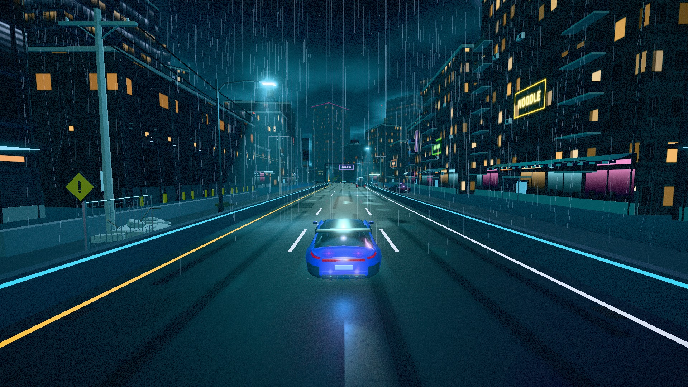

[**Trailer**](#trailer) · [**How it plays**](docs/GAMEPLAY.md) · [**Solana / iDos integration**](docs/IDOS_INTEGRATION.md) · [**Run it**](#run-it) · [**Devlog**](DEVLOG.md)

</div>

---

## What it is

Every night the city rebuilds its own streets. At its center is a moving marker called **Zero Mile**, and a black
car called **The Driver** that has never been beaten there.

Each run is one night. You drive roads built from hand-designed **encounters**: roadblocks, convoys, ambushes,
pursuits and races. You choose your route across **five regions** and beat **five bosses**. Every boss is a driving
problem, not a damage sponge. There are no guns and no auto-fire. You fight by ramming, luring enemies into walls,
drifting, near misses and laying traps. After each road you pick a part, and parts change *how you drive*, not just
your numbers. When you wreck, you go back to the garage, spend SALVAGE and start again.

Around the runs is **the street**, the shared side of the game. It has asynchronous PvP duels, a weekly ranked seed
(the Shift) that every player drives, daily contracts, a player market and a depot. The depot sells in
**MileToken**, the game's Solana token.

**Who it's for:** players who like short, skill-driven runs (*Hades*, *Burnout*, *Vampire Survivors*), and who never
installed a wallet extension for a game. Sign-in takes one free signature, the game runs in a browser tab, and a
guest can play without any wallet.

## Trailer

<!-- Upload trailer/zero-mile-trailer.mp4 (npm run trailer) to YouTube and put the link here -->
**Watch:** *link goes here.* You can record the trailer yourself with `npm run trailer` (see
[Record the trailer](#record-the-trailer)).

**The run:** ram, drift, survive the road, pick parts, choose a route, beat the boss.

| Your car is the weapon | Drift through Old City | The road fights back |
| --- | --- | --- |
| 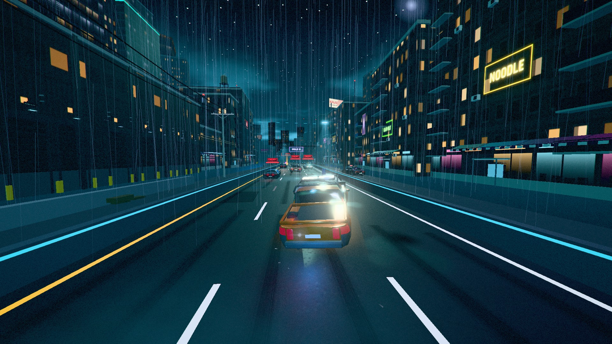 | 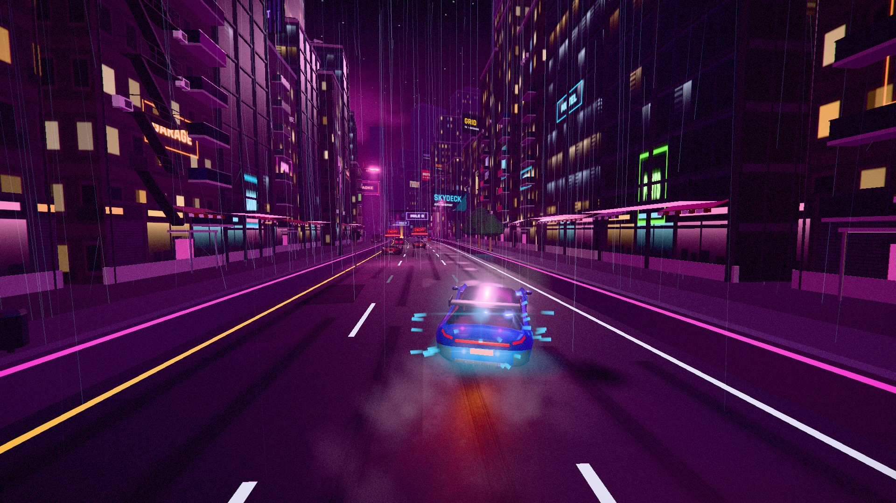 | 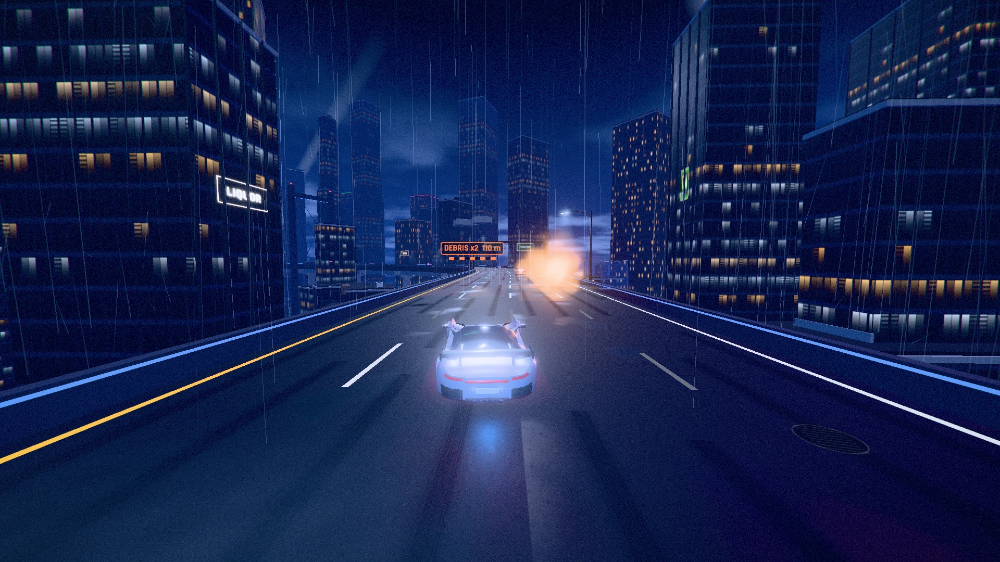 |
| **Pick 1 of 3 parts** | **Choose your route** | **A boss road at Zero Mile** |
| 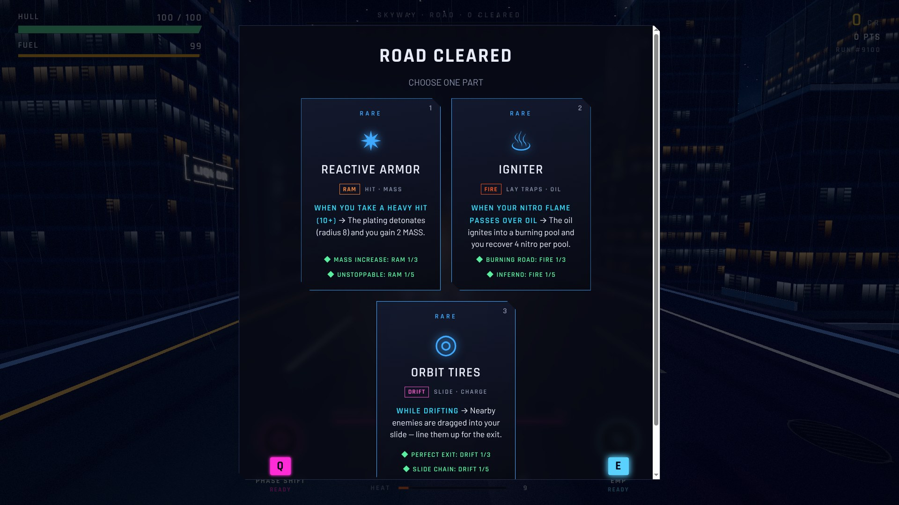 | 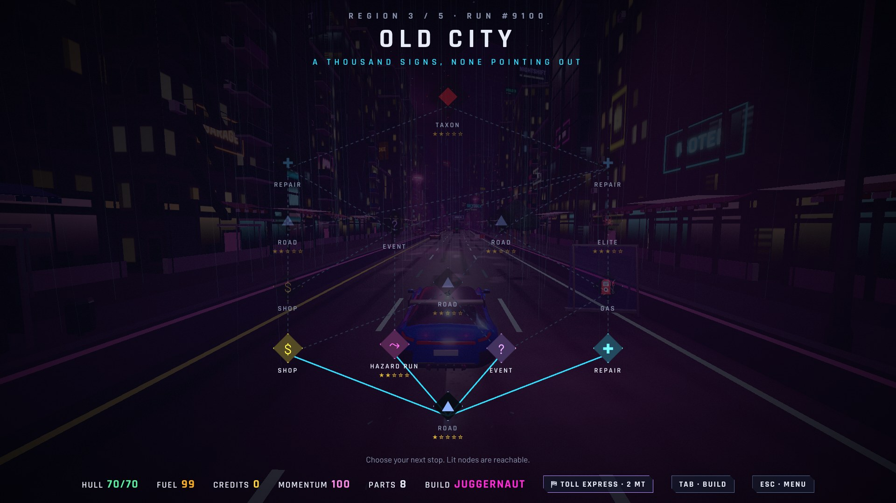 | 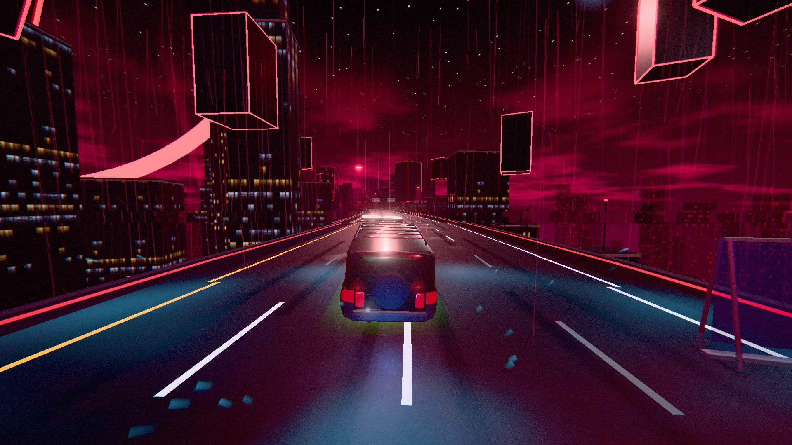 |

**The street:** Solana sign-in, PvP duels, the MileToken depot.

| Sign in with a Solana wallet | The street on the first screen | The garage |
| --- | --- | --- |
| 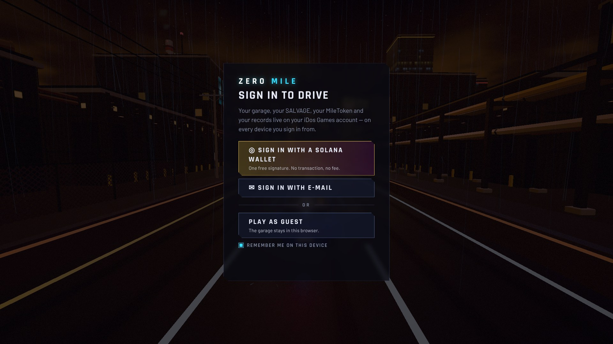 | 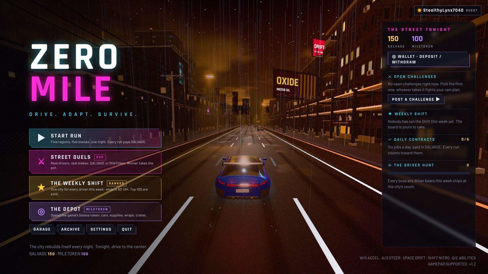 | 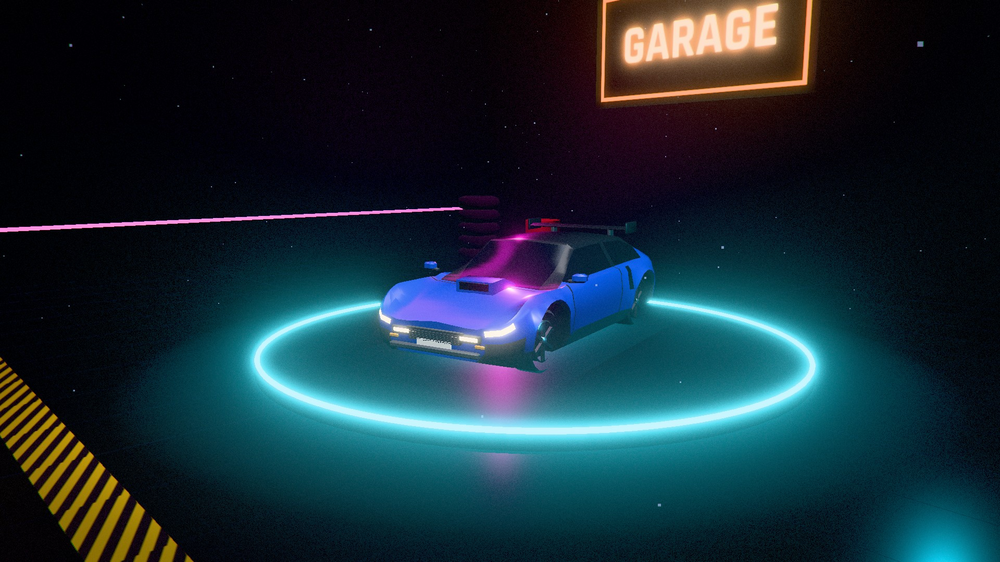 |
| **Async PvP street duels** | **A duel in the pit** | **The depot (MileToken)** |
| 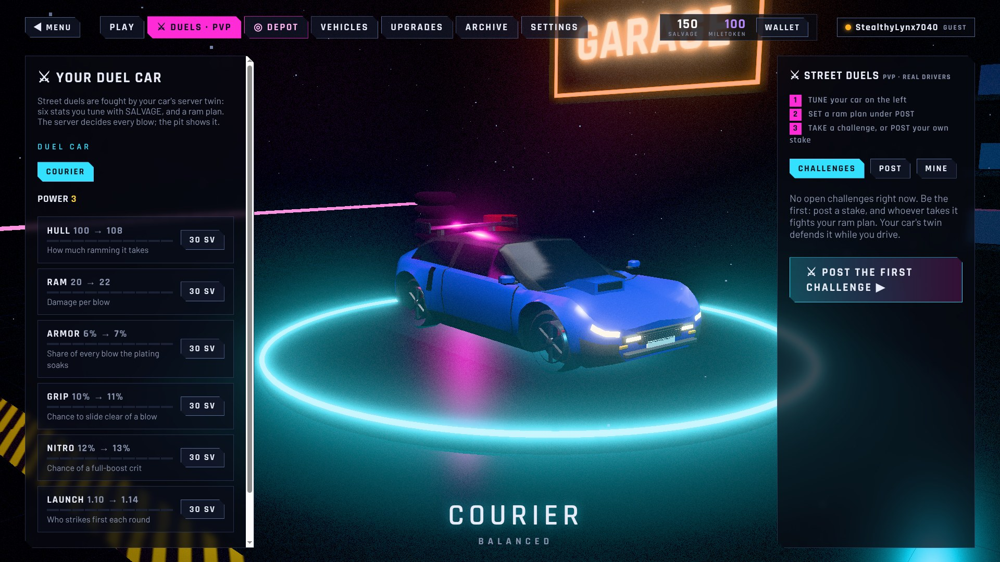 | 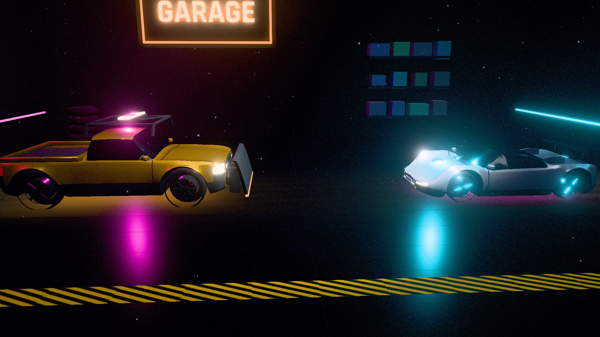 | 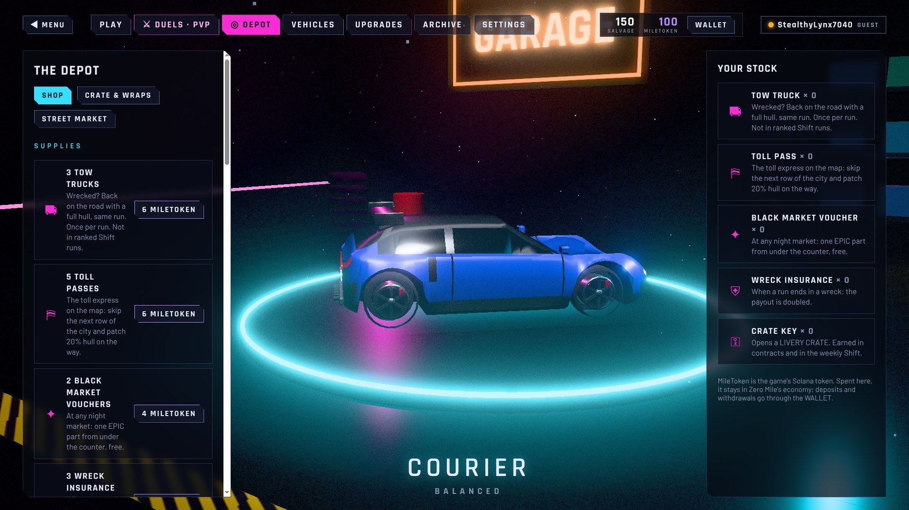 |

## How Solana is used

ZERO MILE is an **[iDos Games](https://idosgames.com)** title (`GJF4GVXP`). iDos Games is a Solana game platform:
accounts, wallets, an in-game economy and Cloud Code. The game talks to it through the `@idosgames/core` and
`@idosgames/wallet` SDKs. The game has no on-chain program of its own. Solana is used for **identity** and
**the token**:

| Where | What happens on Solana |
| --- | --- |
| **Sign-in** | A Solana wallet (Phantom, Solflare or any Wallet Standard wallet) signs the server's challenge. It is one free signature, not a transaction. On a phone with no extension, the game reopens itself inside the Phantom or Solflare app. |
| **The account's wallet** | A linked Solana wallet receives **MileToken** withdrawals. Deposits and withdrawals go through the iDos wallet. |
| **MileToken spending** | Depot offers, the livery crate, supplies bought in the middle of a run (tow truck, toll express, wreck insurance) and the posting fee for the high-stakes MileToken duel. |
| **Token policy** | The game **never mints or grants** MileToken: server grants stay disabled. All MileToken spent goes to the developer share, so play can't print the token. |

Everything that can be cheated runs on the server. Cloud Code checks every run report before it pays SALVAGE
(distance against time, kills against distance, one payout per ticket). Purchases are atomic charge-and-grant
operations. Details are in [docs/IDOS_INTEGRATION.md](docs/IDOS_INTEGRATION.md).

## Features

- **Driving is the combat system.** Ram with T-bones and weak sides, lure enemies into walls, drift for CHARGE, and
  trade risk for reward with three tiers of near miss.
- **Builds that change how you drive.** 35 parts in 6 archetypes (RAM, DRIFT, SPEED, FIRE, ELECTRIC, GHOST),
  12 synergies, 10 abilities and 4 chassis.
- **11 encounter types and 5 bosses.** Each boss is a mechanic you solve: an anvil lane, a flooded bus line, a lane
  predictor, a real race, and The Driver.
- **A city that attacks you.** Debris drops, wrong-way trucks, pile-ups and broken bridges, always announced first.
- **The street (PvP and economy).** Asynchronous duels with a duel garage, a weekly ranked Shift, THE DRIVER hunt,
  daily contracts, liveries, a player market, and the MileToken depot.
- **Five ways to sign in.** Solana wallet, iDos Games account, e-mail, Telegram Mini App, or guest.
- **Everything is procedural and original.** Every 3D model, texture, sound and the adaptive soundtrack are
  generated in code at runtime. The project ships no art or audio files ([ASSETS.md](ASSETS.md)).
- **Built for the browser.** The game holds a steady frame rate in an itch.io iframe. It has a resolution governor,
  shader warm-up, time-sliced world streaming, and a built-in frame profiler (F9).

## Tech stack

| Layer | Technology |
| --- | --- |
| Game | TypeScript 7, Three.js 0.186 (WebGL, custom post-processing), Vite 8 |
| Audio | Web Audio API: procedural engine, SFX and an adaptive soundtrack |
| Platform | iDos Games: `@idosgames/core` 0.21 (accounts, economy, PvP, leaderboards, quests, market) |
| Solana | `@idosgames/wallet` 0.6, Wallet Standard (`@wallet-standard/app`), Phantom / Solflare deep links |
| Server logic | iDos Cloud Code ([idos/cloudcode.template.js](idos/cloudcode.template.js)), with its config generated from the game's own data |
| Tooling | `npm run idos:verify` (58 end-to-end checks against the DEV title), physics bench, frame benchmarks, `npm run trailer` |

## Architecture

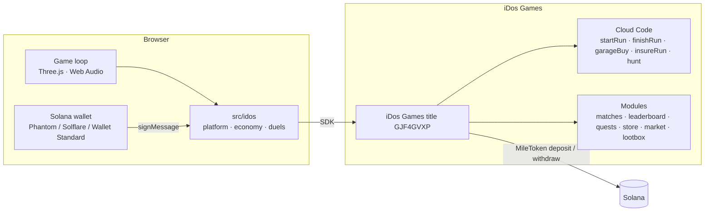

The run itself (driving, AI, bosses, physics) runs on the client and is deterministic per seed. The server opens
each run with a ticket and checks the report when the run closes. The server owns everything with value:
currencies, items, duel outcomes and market settlement.

## Run it

Requires **Node.js 20+**.

```bash
git clone https://github.com/200103474-BorisSyrym/Zero-Mile-Colosseum.git
cd Zero-Mile-Colosseum
npm install
npm run dev
```

Open the URL Vite prints (http://localhost:5173). `npm run dev` plays against the iDos **DEV sandbox**, where a
virtual currency stands in for MileToken. *Continue as guest* gets you driving with no wallet.

```bash
npm run build      # type-check + production build in dist/ (plays against the live title)
npm run package    # itch.io web zip + clean source zip in release/
```

**Controls:** W/S or arrows to drive · A/D to steer · SPACE to drift · SHIFT for nitro · Q/E for abilities · TAB for
your build · ESC to pause. Gamepads are supported. See the full list in [docs/GAMEPLAY.md](docs/GAMEPLAY.md#controls).

### Record the trailer

```bash
npm install
npm run trailer
```

Needs Chrome (or Edge) and [ffmpeg](https://ffmpeg.org) on the PATH (Windows: `winget install ffmpeg`).

1. **Record.** The game opens full screen and each of 16 staged shots is recorded as its own clip:
   - roads driven by the autopilot: combat, drift, road chaos and a boss;
   - the part cards, the build screen and the route map;
   - the garage, the Solana wallet sign-in and the street on the main menu;
   - a PvP duel in the pit, the MileToken depot, the weekly Shift and the end card.
2. **Score.** An original soundtrack is synthesized in code and cut to the same shot list
   ([scripts/trailer-music.mjs](scripts/trailer-music.mjs)): 120 BPM, every cut on the beat, a hit on the title, a
   half-time drop for the boss. The game's music is off while recording; its sound effects stay, under the track.
3. **Cut.** ffmpeg joins the clips with transitions (dissolves, flashes, dips to black, slides between screens) and
   writes `trailer/zero-mile-trailer.mp4`: 1920×1080, 60 fps, about 50 seconds, −14 LUFS.

It takes about two minutes. Leave the window alone until it closes. The same run refreshes the README screenshots in
`docs/media/`.

- `npm run trailer -- --edit-only` re-scores and re-cuts the clips already recorded, without opening the game.
- `npm run trailer -- --music=track.mp3` uses your own track instead of the generated one.

Shots, timings, transitions and titles are in [src/dev/trailer.ts](src/dev/trailer.ts) (`buildShots`).

## Project structure

```
src/
  game/        state machine, run & map, driving session, camera, duels, chaos events
  player/      arcade vehicle physics (grip budget, drift, speed caps, wall severity)
  enemies/     AI vehicles: tasks, telegraphs, weak sides
  bosses/      boss framework (stability, break, vulnerability) and five bosses
  encounters/  encounter director and 11 encounter definitions
  world/       streaming road & city generator, scenery, landmarks
  assets/      every 3D model, built in code
  audio/       procedural Web Audio and the adaptive soundtrack
  idos/        iDos Games: sign-in, Solana wallets, server progression, economy, duels, depot
  ui/          HUD, menus, sign-in and account screens
idos/          Cloud Code script and generated title config (dev / live)
scripts/       packaging, iDos config generation and verification, trailer recorder
docs/          design and technical notes
```

| Doc | What's in it |
| --- | --- |
| [GAMEPLAY.md](docs/GAMEPLAY.md) | Controls, the full rules, bosses, content list |
| [IDOS_INTEGRATION.md](docs/IDOS_INTEGRATION.md) | Sign-in, server progression, Cloud Code checks, the street, MileToken |
| [DEVELOPMENT.md](docs/DEVELOPMENT.md) | Publishing, debug tools, benchmarks, code map |
| [PHYSICS_PASS.md](docs/PHYSICS_PASS.md) · [VFX_PASS.md](docs/VFX_PASS.md) · [VISUAL_PASS.md](docs/VISUAL_PASS.md) · [PERFORMANCE.md](docs/PERFORMANCE.md) | Passes on physics, effects, visuals and performance, with measurements |
| [DEVLOG.md](DEVLOG.md) | Design rework notes and QA results |

## Roadmap

- [x] Full roguelite loop: 5 regions, 11 encounters, 5 bosses, 35 parts, 12 synergies
- [x] iDos Games account with Solana wallet sign-in and server-side progression
- [x] The street: async PvP duels, weekly ranked Shift, contracts, depot, player market, MileToken spending
- [x] Cloud Code run verification, plus 58/58 end-to-end checks on the DEV title
- [ ] Move a guest garage onto a real (wallet) account
- [ ] Withdraw liveries as Solana NFTs (the platform supports it; the wallet SDK has no NFT helper yet)
- [ ] Real-time races, player-made liveries, a season pass in MileToken

## Team

| Name | Role | Contact |
| --- | --- | --- |
| 200103474-BorisSyrym | Solo developer: design, code, art, audio | [GitHub](https://github.com/200103474-BorisSyrym) |

## Credits

Fonts: Rajdhani and Barlow (SIL Open Font License 1.1). Library: three.js (MIT). Everything else is original and was
made for this game. See [ASSETS.md](ASSETS.md).
